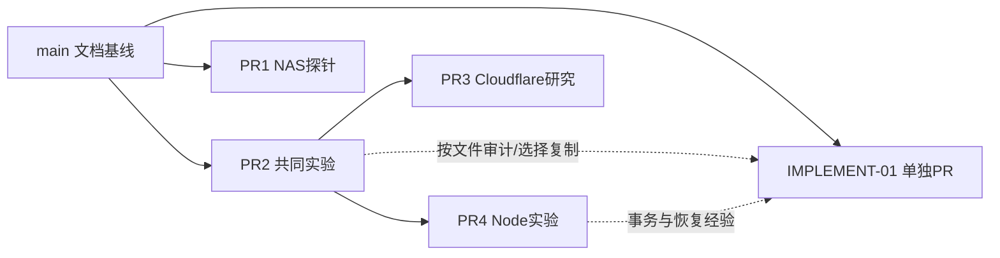

# IMPLEMENT-01 文件级采用矩阵

审查日2026-10-20。远端main仍为 `46687ba370ca7e47764e500641bc371e2c0d4727`；任务分支 `0a803e3418190aa1e875c91b2620c845275d9f14`。#1–#4均OPEN/DRAFT，未合并、未关闭。#2→main；#3/#4→#2分支；本PR独立从main创建，**没有merge/cherry-pick实验分支**。

REUSE表示精确复制的研究/测试资产；REWRITE/ADAPT表示重新实现并保留来源说明；RESEARCH_ONLY不进入应用；DROP_FROM_RUNTIME为明确禁止生产使用的实验部分。没有UNDECIDED文件被默认采用。下面逐项枚举各PR相对其真实base新增/修改的文件，不把#4继承的#2重复算成独立成果。

## PR #1 · `98d22980c2b0d984fde7f7d507ca98173001beb4`

| 来源文件 | 处理 | 新位置 / 依据 |
| --- | --- | --- |
| `.github/workflows/pr-1a.yml` | RESEARCH_ONLY | 保留在原草稿PR作为历史证据；不随本PR迁入runtime |
| `.gitignore` | RESEARCH_ONLY | 保留在原草稿PR作为历史证据；不随本PR迁入runtime |
| `docs/handoff/README.md` | RESEARCH_ONLY | 保留在原草稿PR作为历史证据；不随本PR迁入runtime |
| `docs/handoff/current.md` | RESEARCH_ONLY | 保留在原草稿PR作为历史证据；不随本PR迁入runtime |
| `docs/phase-1/Cloudflare-feasibility-assessment.md` | RESEARCH_ONLY | 保留在原草稿PR作为历史证据；不随本PR迁入runtime |
| `docs/phase-1/PR-1A-execution-report.md` | RESEARCH_ONLY | 保留在原草稿PR作为历史证据；不随本PR迁入runtime |
| `docs/phase-1/PR-1A-nas-validation-report.md` | RESEARCH_ONLY | 保留在原草稿PR作为历史证据；不随本PR迁入runtime |
| `docs/phase-1/PR-1A-runtime-decision.md` | RESEARCH_ONLY | 保留在原草稿PR作为历史证据；不随本PR迁入runtime |
| `docs/phase-1/evidence/pr-1a-nas/checks-and-errors.json` | RESEARCH_ONLY | 保留在原草稿PR作为历史证据；不随本PR迁入runtime |
| `docs/phase-1/evidence/pr-1a-nas/identity.json` | RESEARCH_ONLY | 保留在原草稿PR作为历史证据；不随本PR迁入runtime |
| `docs/phase-1/evidence/pr-1a-nas/index.json` | RESEARCH_ONLY | 保留在原草稿PR作为历史证据；不随本PR迁入runtime |
| `docs/phase-1/evidence/pr-1a-nas/preflight-after.json` | RESEARCH_ONLY | 保留在原草稿PR作为历史证据；不随本PR迁入runtime |
| `docs/phase-1/evidence/pr-1a-nas/preflight-before.json` | RESEARCH_ONLY | 保留在原草稿PR作为历史证据；不随本PR迁入runtime |
| `docs/phase-1/evidence/pr-1a-nas/supplemental-before.json` | RESEARCH_ONLY | 保留在原草稿PR作为历史证据；不随本PR迁入runtime |
| `docs/phase-1/evidence/pr-1a/ci-container.json` | RESEARCH_ONLY | 保留在原草稿PR作为历史证据；不随本PR迁入runtime |
| `docs/phase-1/evidence/pr-1a/ci-preflight.json` | RESEARCH_ONLY | 保留在原草稿PR作为历史证据；不随本PR迁入runtime |
| `docs/phase-1/evidence/pr-1a/compose-version.txt` | RESEARCH_ONLY | 保留在原草稿PR作为历史证据；不随本PR迁入runtime |
| `docs/phase-1/evidence/pr-1a/index.json` | RESEARCH_ONLY | 保留在原草稿PR作为历史证据；不随本PR迁入runtime |
| `docs/phase-1/evidence/pr-1a/local-preflight.json` | RESEARCH_ONLY | 保留在原草稿PR作为历史证据；不随本PR迁入runtime |
| `docs/phase-1/evidence/pr-1a/local-summary.json` | RESEARCH_ONLY | 保留在原草稿PR作为历史证据；不随本PR迁入runtime |
| `docs/phase-1/evidence/pr-1a/nas-plan.json` | RESEARCH_ONLY | 保留在原草稿PR作为历史证据；不随本PR迁入runtime |
| `docs/phase-1/evidence/pr-1a/node-tests.txt` | RESEARCH_ONLY | 保留在原草稿PR作为历史证据；不随本PR迁入runtime |
| `docs/phase-1/evidence/pr-1a/preflight-exit.json` | RESEARCH_ONLY | 保留在原草稿PR作为历史证据；不随本PR迁入runtime |
| `docs/phase-1/evidence/pr-1a/python-tests.txt` | RESEARCH_ONLY | 保留在原草稿PR作为历史证据；不随本PR迁入runtime |
| `docs/tasks/KLH-PR-1A-NAS.md` | RESEARCH_ONLY | 保留在原草稿PR作为历史证据；不随本PR迁入runtime |
| `docs/tasks/KLH-PR-1A.md` | RESEARCH_ONLY | 保留在原草稿PR作为历史证据；不随本PR迁入runtime |
| `infra/probes/node-sqlite/Dockerfile` | RESEARCH_ONLY | 保留在原草稿PR作为历史证据；不随本PR迁入runtime |
| `infra/probes/node-sqlite/README.md` | RESEARCH_ONLY | 保留在原草稿PR作为历史证据；不随本PR迁入runtime |
| `infra/probes/node-sqlite/compose.yml` | RESEARCH_ONLY | 保留在原草稿PR作为历史证据；不随本PR迁入runtime |
| `infra/probes/node-sqlite/image-lock.json` | RESEARCH_ONLY | 保留在原草稿PR作为历史证据；不随本PR迁入runtime |
| `infra/probes/node-sqlite/probe.mjs` | RESEARCH_ONLY | 保留在原草稿PR作为历史证据；不随本PR迁入runtime |
| `package.json` | RESEARCH_ONLY | 保留在原草稿PR作为历史证据；不随本PR迁入runtime |
| `scripts/nas-preflight.sh` | RESEARCH_ONLY | 保留在原草稿PR作为历史证据；不随本PR迁入runtime |
| `scripts/nas_preflight.py` | RESEARCH_ONLY | 保留在原草稿PR作为历史证据；不随本PR迁入runtime |
| `scripts/run_sqlite_probe.py` | RESEARCH_ONLY | 保留在原草稿PR作为历史证据；不随本PR迁入runtime |
| `tests/sqlite-probe.test.mjs` | RESEARCH_ONLY | 保留在原草稿PR作为历史证据；不随本PR迁入runtime |
| `tests/test_preflight.py` | RESEARCH_ONLY | 保留在原草稿PR作为历史证据；不随本PR迁入runtime |
| `tests/test_runner.py` | RESEARCH_ONLY | 保留在原草稿PR作为历史证据；不随本PR迁入runtime |

## PR #2 · `398074ea72cea1b41cfc837f43d49009f159f8aa`

| 来源文件 | 处理 | 新位置 / 依据 |
| --- | --- | --- |
| `.github/workflows/bench-common.yml` | RESEARCH_ONLY | 保留在原草稿PR作为历史证据；不随本PR迁入runtime |
| `.gitignore` | RESEARCH_ONLY | 保留在原草稿PR作为历史证据；不随本PR迁入runtime |
| `docs/benchmarks/BENCH-00-common-protocol.md` | RESEARCH_ONLY | 保留在原草稿PR作为历史证据；不随本PR迁入runtime |
| `docs/benchmarks/BENCH-03-side-by-side-decision.md` | RESEARCH_ONLY | 保留在原草稿PR作为历史证据；不随本PR迁入runtime |
| `docs/benchmarks/results/shared/baseline-parity.json` | RESEARCH_ONLY | 保留在原草稿PR作为历史证据；不随本PR迁入runtime |
| `docs/handoff/platform-benchmarks.md` | RESEARCH_ONLY | 保留在原草稿PR作为历史证据；不随本PR迁入runtime |
| `docs/tasks/KLH-BENCH-00-COMPARISON.md` | RESEARCH_ONLY | 保留在原草稿PR作为历史证据；不随本PR迁入runtime |
| `docs/tasks/KLH-BENCH-01-CLOUDFLARE.md` | RESEARCH_ONLY | 保留在原草稿PR作为历史证据；不随本PR迁入runtime |
| `docs/tasks/KLH-BENCH-02-NODE-NAS.md` | RESEARCH_ONLY | 保留在原草稿PR作为历史证据；不随本PR迁入runtime |
| `experiments/shared/api.mjs` | DROP_FROM_RUNTIME | 实验身份、mock对象、合成课程、假奖励和原型UI不进入正式app；正式入口关闭学习写入 |
| `experiments/shared/domain.mjs` | DROP_FROM_RUNTIME | 实验身份、mock对象、合成课程、假奖励和原型UI不进入正式app；正式入口关闭学习写入 |
| `experiments/shared/media-mock.mjs` | DROP_FROM_RUNTIME | 实验身份、mock对象、合成课程、假奖励和原型UI不进入正式app；正式入口关闭学习写入 |
| `experiments/shared/repository.mjs` | REWRITE/ADAPT | canonical排序与receipt/hash/CAS语义→contracts、platform/store.ts；改用同步BEGIN IMMEDIATE，不复制无限状态分片/奖励 |
| `experiments/shared/schema.sql` | REWRITE/ADAPT | 重建001-foundation.sql：独立迁移校验、有界projection、不可变event/receipt、关系引用；不复制实验auth/reward |
| `experiments/shared/vendor/english.mjs` | RESEARCH_ONLY | 保留在原草稿PR作为历史证据；不随本PR迁入runtime |
| `experiments/shared/vendor/math/content/pets/catalog.json` | RESEARCH_ONLY | 保留在原草稿PR作为历史证据；不随本PR迁入runtime |
| `experiments/shared/vendor/math/content/pilot/thinking-deeper-variants.mjs` | RESEARCH_ONLY | 保留在原草稿PR作为历史证据；不随本PR迁入runtime |
| `experiments/shared/vendor/math/content/pilot/thinking-hints.mjs` | RESEARCH_ONLY | 保留在原草稿PR作为历史证据；不随本PR迁入runtime |
| `experiments/shared/vendor/math/content/pilot/thinking-publication.mjs` | RESEARCH_ONLY | 保留在原草稿PR作为历史证据；不随本PR迁入runtime |
| `experiments/shared/vendor/math/content/pilot/thinking-source.mjs` | RESEARCH_ONLY | 保留在原草稿PR作为历史证据；不随本PR迁入runtime |
| `experiments/shared/vendor/math/content/pilot/thinking-variants.mjs` | RESEARCH_ONLY | 保留在原草稿PR作为历史证据；不随本PR迁入runtime |
| `experiments/shared/vendor/math/server/pet-care.mjs` | RESEARCH_ONLY | 保留在原草稿PR作为历史证据；不随本PR迁入runtime |
| `experiments/shared/vendor/math/server/pilot-core.mjs` | RESEARCH_ONLY | 保留在原草稿PR作为历史证据；不随本PR迁入runtime |
| `experiments/shared/vendor/math/server/pilot-store.mjs` | RESEARCH_ONLY | 保留在原草稿PR作为历史证据；不随本PR迁入runtime |
| `experiments/shared/vendor/math/server/review-schedule.mjs` | RESEARCH_ONLY | 保留在原草稿PR作为历史证据；不随本PR迁入runtime |
| `experiments/shared/vendor/math/server/thinking-store.mjs` | RESEARCH_ONLY | 保留在原草稿PR作为历史证据；不随本PR迁入runtime |
| `experiments/shared/vendor/math/shared/core-models.mjs` | RESEARCH_ONLY | 保留在原草稿PR作为历史证据；不随本PR迁入runtime |
| `experiments/shared/vendor/math/shared/hands-on-models.mjs` | RESEARCH_ONLY | 保留在原草稿PR作为历史证据；不随本PR迁入runtime |
| `experiments/shared/vendor/math/shared/operation-models.mjs` | RESEARCH_ONLY | 保留在原草稿PR作为历史证据；不随本PR迁入runtime |
| `experiments/shared/vendor/math/shared/pilot-math.mjs` | RESEARCH_ONLY | 保留在原草稿PR作为历史证据；不随本PR迁入runtime |
| `experiments/shared/vendor/math/shared/textbook-models.mjs` | RESEARCH_ONLY | 保留在原草稿PR作为历史证据；不随本PR迁入runtime |
| `experiments/shared/vendor/math/shared/thinking-tools.mjs` | RESEARCH_ONLY | 保留在原草稿PR作为历史证据；不随本PR迁入runtime |
| `experiments/shared/vendor/math/shared/widget-state.mjs` | RESEARCH_ONLY | 保留在原草稿PR作为历史证据；不随本PR迁入runtime |
| `experiments/shared/vendor/math/shared/withdrawn-checks.mjs` | RESEARCH_ONLY | 保留在原草稿PR作为历史证据；不随本PR迁入runtime |
| `experiments/shared/web/app.js` | DROP_FROM_RUNTIME | 实验身份、mock对象、合成课程、假奖励和原型UI不进入正式app；正式入口关闭学习写入 |
| `experiments/shared/web/index.html` | DROP_FROM_RUNTIME | 实验身份、mock对象、合成课程、假奖励和原型UI不进入正式app；正式入口关闭学习写入 |
| `experiments/shared/web/style.css` | DROP_FROM_RUNTIME | 实验身份、mock对象、合成课程、假奖励和原型UI不进入正式app；正式入口关闭学习写入 |
| `package-lock.json` | RESEARCH_ONLY | 保留在原草稿PR作为历史证据；不随本PR迁入runtime |
| `package.json` | RESEARCH_ONLY | 保留在原草稿PR作为历史证据；不随本PR迁入runtime |
| `tests/platform-parity/browser-suite.mjs` | RESEARCH_ONLY | 保留在原草稿PR作为历史证据；不随本PR迁入runtime |
| `tests/platform-parity/business-suite.mjs` | REWRITE/ADAPT | 仅采用幂等/CAS/事务/恢复验收要求；正式最小schema与HTTP测试另写，不复制旧学科测试冒充整合 |
| `tests/platform-parity/contract-v1.md` | REWRITE/ADAPT | 仅采用幂等/CAS/事务/恢复验收要求；正式最小schema与HTTP测试另写，不复制旧学科测试冒充整合 |
| `tests/platform-parity/extended-suite.mjs` | REWRITE/ADAPT | 仅采用幂等/CAS/事务/恢复验收要求；正式最小schema与HTTP测试另写，不复制旧学科测试冒充整合 |
| `tests/platform-parity/fixture-lock.json` | REUSE | 精确复制到 `tests/provenance/fixture-lock.json`；本轮不运行旧学科算法，不以这些历史fixture证明正式课程兼容 |
| `tests/platform-parity/fixture-v1.json` | REUSE | 精确复制到 `tests/provenance/fixture-v1.json`；本轮不运行旧学科算法，不以这些历史fixture证明正式课程兼容 |
| `tests/platform-parity/run-platform.mjs` | RESEARCH_ONLY | 保留在原草稿PR作为历史证据；不随本PR迁入runtime |
| `tests/platform-parity/schema-v1.json` | REWRITE/ADAPT | 仅采用幂等/CAS/事务/恢复验收要求；正式最小schema与HTTP测试另写，不复制旧学科测试冒充整合 |
| `tests/platform-parity/source-lock.json` | REUSE | 精确复制到 `tests/provenance/source-lock.json`；本轮不运行旧学科算法，不以这些历史fixture证明正式课程兼容 |
| `tests/platform-parity/source-parity.test.mjs` | RESEARCH_ONLY | 保留在原草稿PR作为历史证据；不随本PR迁入runtime |

## PR #4 · `ca56951e0f4e3df841a129bee560abbeaa29acf2`

| 来源文件 | 处理 | 新位置 / 依据 |
| --- | --- | --- |
| `.github/workflows/bench-nas-image.yml` | RESEARCH_ONLY | 保留在原草稿PR作为历史证据；不随本PR迁入runtime |
| `.github/workflows/bench-node.yml` | RESEARCH_ONLY | 保留在原草稿PR作为历史证据；不随本PR迁入runtime |
| `docs/benchmarks/BENCH-02-hardware-cost-model.md` | RESEARCH_ONLY | 保留在原草稿PR作为历史证据；不随本PR迁入runtime |
| `docs/benchmarks/BENCH-02-node-nas-report.md` | RESEARCH_ONLY | 保留在原草稿PR作为历史证据；不随本PR迁入runtime |
| `docs/benchmarks/BENCH-02-operations-and-recovery.md` | RESEARCH_ONLY | 保留在原草稿PR作为历史证据；不随本PR迁入runtime |
| `docs/benchmarks/results/node/ci.json` | RESEARCH_ONLY | 保留在原草稿PR作为历史证据；不随本PR迁入runtime |
| `docs/benchmarks/results/node/container-ci.json` | RESEARCH_ONLY | 保留在原草稿PR作为历史证据；不随本PR迁入runtime |
| `docs/benchmarks/results/node/local.json` | RESEARCH_ONLY | 保留在原草稿PR作为历史证据；不随本PR迁入runtime |
| `docs/benchmarks/results/node/nas-browser.json` | RESEARCH_ONLY | 保留在原草稿PR作为历史证据；不随本PR迁入runtime |
| `docs/benchmarks/results/node/nas-frontend-provenance.json` | RESEARCH_ONLY | 保留在原草稿PR作为历史证据；不随本PR迁入runtime |
| `docs/benchmarks/results/node/nas-image-provenance.json` | RESEARCH_ONLY | 保留在原草稿PR作为历史证据；不随本PR迁入runtime |
| `docs/benchmarks/results/node/nas-preflight-20261014.json` | RESEARCH_ONLY | 保留在原草稿PR作为历史证据；不随本PR迁入runtime |
| `docs/benchmarks/results/node/nas-raw.json` | RESEARCH_ONLY | 保留在原草稿PR作为历史证据；不随本PR迁入runtime |
| `docs/benchmarks/results/node/nas-verification.json` | RESEARCH_ONLY | 保留在原草稿PR作为历史证据；不随本PR迁入runtime |
| `docs/handoff/BENCH-02.md` | RESEARCH_ONLY | 保留在原草稿PR作为历史证据；不随本PR迁入runtime |
| `experiments/node/Dockerfile` | REWRITE/ADAPT | 重新实现现代Linux容器持久化验收/正式多阶段镜像；不继承实验运行方式 |
| `experiments/node/Dockerfile.nas` | REWRITE/ADAPT | 重新实现现代Linux容器持久化验收/正式多阶段镜像；不继承实验运行方式 |
| `experiments/node/adapter.mjs` | REWRITE/ADAPT | SQLite PRAGMA回读、BEGIN IMMEDIATE与VACUUM INTO经验→platform；加writer锁、迁移校验与一致媒体checkpoint |
| `experiments/node/container-suite.mjs` | REWRITE/ADAPT | 重新实现现代Linux容器持久化验收/正式多阶段镜像；不继承实验运行方式 |
| `experiments/node/harness.mjs` | DROP_FROM_RUNTIME | 不带入假身份、测试故障开关、sudo启动器或旧端口；只提取已有实测风险写入部署设计 |
| `experiments/node/nas-browser.mjs` | RESEARCH_ONLY | 保留在原草稿PR作为历史证据；不随本PR迁入runtime |
| `experiments/node/nas-launch.sh` | DROP_FROM_RUNTIME | 不带入假身份、测试故障开关、sudo启动器或旧端口；只提取已有实测风险写入部署设计 |
| `experiments/node/nas-suite.mjs` | DROP_FROM_RUNTIME | 不带入假身份、测试故障开关、sudo启动器或旧端口；只提取已有实测风险写入部署设计 |
| `experiments/node/server.mjs` | DROP_FROM_RUNTIME | 不带入假身份、测试故障开关、sudo启动器或旧端口；只提取已有实测风险写入部署设计 |

## Cloudflare、旧学科和待审项

PR #3 `7caecac7089536926eface6a054ac7dc009f5c81` 整条路线为RESEARCH_ONLY，没有Worker/D1/Miniflare/Wrangler或云SDK生产依赖。以后是否继续真云验证、存储provider、正式认证/parent grants、未知历史字段与归档策略仍待独立审查，本PR不自动选择。

数学将来来源仍锁定 `8e9115442b3978eee0d4821750ce04f47954bd26`，英语 `d0b42a8872a7e87433b96770519203630223b6f2`。本轮数学本地HEAD已由其他工作推进到 `a7c05aaa8d9c5eabae4f3453807f830da1cbf279`，**不将此变化归于本任务，不替换未来迁移冻结源**。本任务前后只读Git审计；未运行旧站构建/测试/启动器，未读其DB/localStorage/PIN/词包，未更改部署、origin、账户或服务。源独立性元数据见 evidence/source-independence.json。

旧网站继续是各自真实记录权威来源。新app不读旧仓库，不动态git拉代码，无iframe，不共享数据库、账户或localStorage；未来只能在批准后一次性复制固定源到新仓库，再在新仓库独立适配，不反向同步。

建议保留#1/#2/#3/#4作为研究与审查证据；待相关意见提取完，由用户决定是否关闭。不建议逐个merge；本轮不执行关闭或合并。机器可核对的完整文件hash矩阵见 evidence/adoption-files.json。
