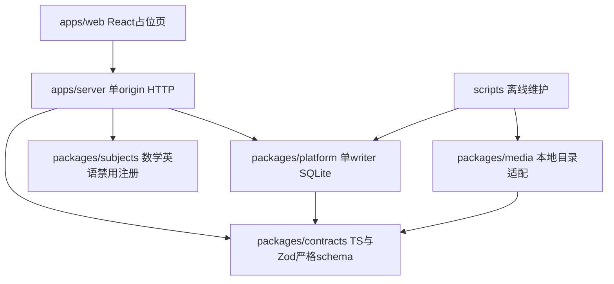

# IMPLEMENT-01 架构与边界

本阶段只交付工程底座。正式运行目标为Node24.15.0/SQLite/React的模块化单体；身份认证、学科迁移、奖励和真实数据仍未实现。Phase0 ADR保持历史Proposed状态，未把未验收ARCH-02/R2方案改成Accepted。

## 模块与依赖

npm workspaces共6个边界：apps/web、apps/server、packages/contracts/platform/media/subjects。使用Node24内建类型擦除运行服务端TS，`tsc --noEmit`单独检查；Vite构建浏览器JS，单容器Node同时提供静态文件和API，没有iframe、微服务或旧仓库运行时依赖。测试入口位于tests/foundation，不复制进runtime镜像。scripts/synthetic.ts也不进镜像；三个历史provenance JSON只做来源留档。

UI只提供数学/英语待迁入导航，零学习记录、零写请求，未设置登录/家长账号/伪进度。浅蓝纸面、深蓝文字、蓝绿学科标识；本地系统字体，无外链字体、素材或云资源。键盘焦点、390px/768px/1280px导航与刷新测试保留。物理iPad/Safari NOT_RUN。

## 存储schema与版本

| 表 | 本阶段职责 |
| --- | --- |
| schema_migrations | 版本1、迁移SQL SHA256、执行时间；user_version同步 |
| learners / subjects | 仅合成learner CHECK(synthetic=1)，科目注册；真实learner尚不支持 |
| subject_states | (learner,subject)唯一，revision，schema/content版本；projection UTF8最多4096bytes |
| server_attempts | 服务端签发的合成attempt与learner/subject/content版本绑定 |
| learning_events | 独立行、不可变trigger、learner/subject/revision索引；payload最多16384bytes |
| command_receipts | (learner,commandId)唯一，请求hash、原结果和提交revision；不可变 |
| media_assets / content_manifests | 稳定assetId/version、内容subjectId/contentVersion；仅元数据与小manifest |
| content_media_refs | 课程版本→媒体版本的FK关系 |
| audit_log | 操作名/时间/小元数据，不写答案、令牌或凭证 |

新空库执行一次migration；已有版本必须与SQL SHA及sqlite_schema列/索引/trigger完全一致。未来版本、旧的无版本非空库、增列漂移、迁移checksum漂移拒绝启动，不自动清库或降级。未来schema升级必须新增独立迁移和预览/备份关卡。

每个Store通过 `fs-ext` 持有稳定 `.writer.lock` inode 的内核排他 flock，拒绝第二个app/维护工具；发布后的锁文件永不自动删除，FD关闭或进程死亡释放所有权；事务同步BEGIN IMMEDIATE，不跨await等网络。回读WAL、FULL、FK、busy_timeout3000；已知NFS/CIFS/SMB/FUSE文件系统拒绝，目录要求canonical本地路径、数据库拒绝软链接。真实NAS目录和挂载性质仍须部署前只读preflight批准；当前代码识别已知不适配类型，不声称能证明所有未知远端文件系统都本地。

只用有界cursor投影，不将十年完整状态塞单行；每事件一行，媒体只在独立volume。旧完整快照/未知字段保真、归档和原课程证据尚属未来迁移PR，不能用本schema保存成功宣称历史逐字段迁移完成。

## 命令、测试身份与错误

正式入口apps/server/main.ts不加载测试身份；即使NODE_ENV=test也拒绝正式入口启动。正式/api/v1/config只返回禁用状态；所有学习、auth、parent、媒体、钱包API都403 FEATURE_DISABLED。不设置cookie、不接受Tailscale/X-Role为授权，不开放默认账号。Host固定匹配配置，静态资源仅白名单页面/assets，限制CSP和no-store。

只有测试runner显式NODE_ENV=test，调用createHttp并注入随机测试session resolver，才能在回环HTTP测试foundation-demo。它不是生产认证、CSRF或家长grants的实现；正式权限仍需下一独立安全PR。测试session A/B是独立随机bearer token，不持久化、不用于旧站、不进入镜像。

最小命令沿用Phase0的schemaVersion/contentVersion/commandId/expectedRevision/occurredAt/serverAttemptId/learnerId/subjectId、Idempotency-Key语义；仅实现`observe-reading`和合成cursor input.position，拒绝未知字段及correct/coins/trustLevel。不是数学或英语判分。学习事实是合成、ungraded、unassessed，不发币。

同key同hash返回原event/result和committedRevision，另给currentRevision；同key换payload409 IDEMPOTENCY_CONFLICT；旧revision409 STALE_REVISION；非服务器attempt409。收据、事件、投影、审计同事务提交，尾部真实SQL约束故障全回滚。requestId不进入业务hash；错误只给版本化code/retryable/currentRevision，不暴露文件路径/SQL/凭证。测试故障注入是进程内函数，不是HTTP头或公开API。

## 媒体、内容和迁移

MediaAsset有assetId/version/hash/MIME/size、public/private、授权/来源、logical storageKey/contentRefs。课程只引用assetId+version；无NAS绝对路径或云URL。LocalMediaStorage是薄MediaStorage接口，root可替换；本轮只验证两个本地根目录切换，七牛/R2/S3均未实现。

拒绝绝对路径、空段、../、反斜线、文件/父目录/root软链接；读取使用O_NOFOLLOW，并要求应用独占已发布目录，不对同UID恶意并发目录替换提供沙箱保证。public不能声明private-owner；private只允许内部明确授权读参数，**生产没有可调用媒体路由**，此参数不能代替未来真正用户授权。MIME当前校验元数据允许值，尚无不可信上传/媒体转码管线。

小文件读取限制8MiB；更大文件返回MEDIA_STREAM_REQUIRED，未来gateway必须实现受控流式/Range，不能把此方法当视频交付器。备份/恢复/验证使用64KiB分块复制/哈希，逐表摘要用SQLite iterate，不把全部对象或全库JSON装内存。checkpoint manifest读取上限2MiB，海量对象未来需分片manifest；十TB真实拷贝/性能未测试。数据/媒体/内容/备份生命周期独立，媒体不进SQLite BLOB、前端bundle或app镜像。

## 可移植性与当前风险

固定linux/amd64 Node镜像tag与registry manifest digest；非root、只读rootfs、独立data/media/content挂载。现代Linux CI执行删容器/同卷重建，以及恢复到新host目录后同镜像健康检查；没有在NAS部署本底座。

DS918+ Linux4.4.180+低于Node24 glibc官方x64 >=4.18基线。10月14日实验PASS_NAS只证明当时可执行，不是官方支持或生产稳定验收。CPU cpuset可限制单逻辑CPU，但CFS quota/PIDs上限在旧内核未生效，本Compose不声称提供这些控制。Node24/node:sqlite当前版本仍需升级与回归计划。[官方Node24支持表](https://github.com/nodejs/node/blob/v24.15.0/BUILDING.md#platform-list)、[SQLite RC状态](https://nodejs.org/download/release/v24.15.0/docs/api/sqlite.html)。

R1将writer所有权改为内核flock生命周期；SIGTERM/SIGKILL及现代Linux容器恢复证据见 [R1报告](IMPLEMENT-01-review-R1.md)。旧v1标记必须在全部旧写入者及重启策略停止后显式离线迁移，不能用PID或超时判死并删除文件。真正断电/坏盘、NAS底座、HTTPS/认证/CSRF、长时间运行、真实备份保密/异地保存、架构arm64/Android仍未验收。下一PR优先生产认证/授权，再正式shell，之后才按冻结源逐科复制适配。
