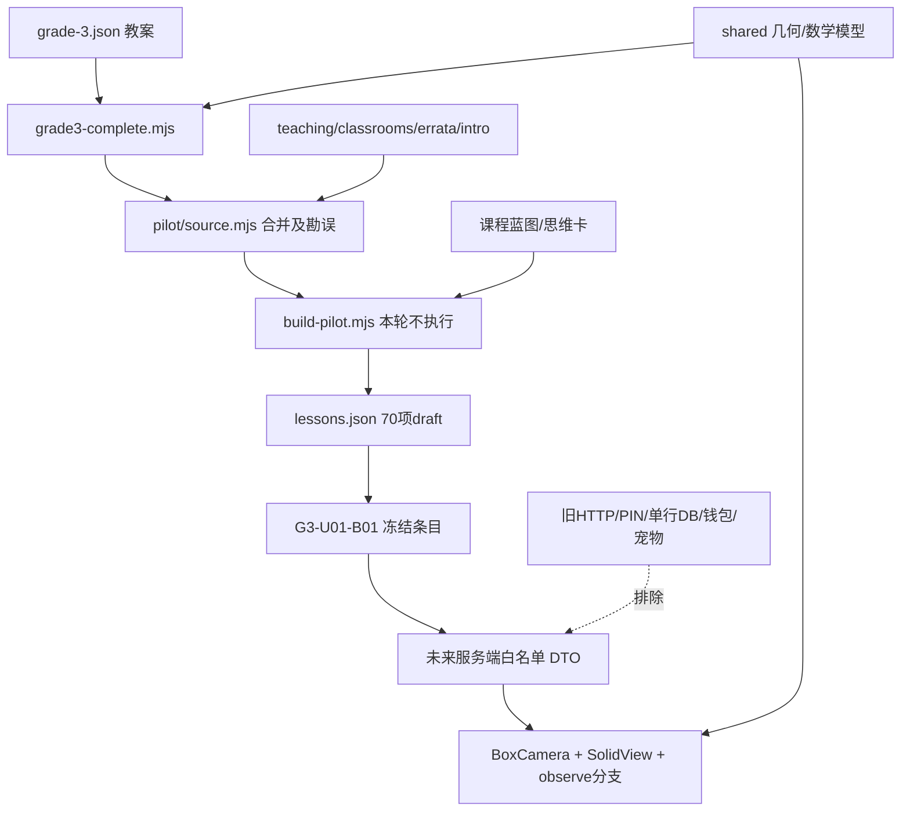

# MATH-00 冻结数学来源审计与首课准备

2026-10-24归档，任务书：[Issue #9](https://github.com/lovestream/kevin-learning-home/issues/9)。从最新main `5ccd196` 建立 `codex/math-00-source-audit`。本轮只提交来源审计、白名单候选、合同、验证工具与交接；**课程源码复制0文件、应用运行代码改动0、真实记录读取0、NAS连接/部署0**。MATH-01需本轮独立审查通过后另开PR。

## 上游验收与冻结

PR8已合并`8b99528dbbfca186770f629007225903a89b2875`；NAS正式试用app仍来自PR7合并`7790da6`。用户手机/iPad真实访问和登录已成功，不扩大为全部业务/生产/Tailscale验收。本轮保留现有试用容器、数据和7天CA，不清理或重建；CA到期后需要单独安排新证书，不能降低TLS校验或更改生产证书。

唯一数学来源为`lovestream/math-learning@a7c05aaa8d9c5eabae4f3453807f830da1cbf279`。英语只记录`word-request@d0b42a8872a7e87433b96770519203630223b6f2`的HEAD和工作区状态指纹，读取英语blob为0，原1项未跟踪文件不打开、不改动。数学HEAD必须等于冻结点，先核验再读blob；不隐式跟随latest。

[结构化清单](evidence/math-00/source-inventory.json)逐项包含路径、原Git blob、SHA256、字节数、allow/adapt/exclude、用途/目标/许可理由、是否为原17以外新增、MATH-01具体选择范围及全部静态依赖边。70个唯一lessonId、4个contentVersion、70项status=draft已核对；首课`G3-U01-B01`：contentVersion=`2026-10-07.2`，editorialRevision=`2026-10-09.4`，仍draft/review-required。12个练习taskId（warmup2/core3/transfer2/challenge1/review4）只记录ID/计数，未复制题干/标准答案。已验证原17个hash完全相符，它们只是审计起点，不是完整复制清单。

## 方法、覆盖与限制

`python3 scripts/math-audit/generate.py --source-repo <本机math-learning>`只调用git rev-parse/status/ls-tree/show，`GIT_OPTIONAL_LOCKS=0`；不执行旧JS、导入旧模块、读取旧工作区文件或运行build/prebuild/pretest。所有被审计blob固定SHA、必须tracked；私有路径在read前拒绝。图片/模板仅对获准tracked资产计算hash/静态审计，不将其内容复制到新项目。输出不含课程正文/答案值/数据文件/密钥/私有词包。

闭包由literal import/export/动态literal import、CSS url/import及**人工审读的readFileSync/生成资源边**构成；它不是完整JavaScript AST/动态执行证明。人工补边明确覆盖grade3-complete读取grade-3.json、thinking-source读取grade-3-thinking.json、catalog旧seed、蓝图和五个折纸输入/输出。实际数据/恢复密钥/inbox读取在旧服务边界停止，不能追到运行资料。当前没有未裁定的nonliteral import；server中`import(?:...)`正则不是模块导入，方法`.import()`也不是。新增依赖或动态来源须FAIL/补审，不能因正则没看到就默认安全。

不运行生成器，因此**未声明重新构建后与提交的lessons.json逐字节相等**。首课读取冻结提交的已跟踪生成物，源/生成物hash分别绑定；生成源和教学计划用于追溯，未来不借复制之名重生成/修订70课。`content/catalog.json`和`content/grade-3/catalog.json`是被忽略的生成物，只记录producer/consumer，不打开工作区现存版本，也不把它们当缺失可读输入。

本机source-inventory的前后数学HEAD/status指纹一致，英语边界另见boundary证据。状态核验不读取/比较真实数据库内容，不声称监控旧站独立运行时自行发生的学习写入；本轮所有命令均未向旧站发学习请求。

## 构建、运行与首课资源闭包

运行选择链：`ChildClassroom`查找`articleBlocks`的`try`/`conceptLab` → `TeachingDiagrams` → `ConceptWorkbench` → `handsOnSpec.type=spatial` → `SpatialWorkbench`，本课mode=`observe`，模型version=`spatial.v2`、scene=`G3-U01-B01-MODEL1`。`IntroVisual`使用`box-camera`并调用`SolidView`，几何来自`boxFaces/faces`与`composeSolid/tint`。图形由受审JSX生成inline SVG，**不是从assetIds下载SVG文件**。

未来MATH-01只选择清单中9个来源条目的部分代码/单课DTO：8个视觉/样式/运动来源与`lessons.json`的单课投影。具体selector在每行math01Scope；只有2个纯几何模块也必须避免把无关模型/题库常量一起打进包。不是批准复制整个9文件，更不是整个133文件闭包。

| 关键来源 | 逐项裁定 |
| --- | --- |
| `src/studio/ChildClassroom.tsx` | 审计参考，不能原样挂载：会取完整taskSets.core/withdrawnTasks、暴露练习入口，并通过change保存状态。新只读壳保留原六步顺序与教学文本，步骤6仅显示练习尚未接入，不发送任务数据。 |
| `src/studio/IntroVisual.tsx` | 选BoxCamera及必要Canvas/Camera/文字辅助；不包含其它课分支。其它分支存在inline style，不能为全文件复制给CSP加unsafe-inline。 |
| `SpatialWorkbench.tsx` | 只选observe、Projection和相机方向/临时照片；排除hidden/fold、打印链接、答案核对、完成判定。 |
| `SolidView.tsx` | 保留几何投影与Arrow键操作、pointer cancel、useId去重；SVG url(#本地ID)是同文档渐变，不是网络资源。 |
| `useHandsOn.tsx` | 仅审计；原操作轨迹含时间戳并向上onChange，toolbar声称“操作会保存”。未来用明确的本页内存状态，不能偷偷接入存储或保留虚假保存提示。 |
| `useMotionValue.ts`、两份视觉CSS | 保留reduced-motion与RAF清理，选择observe/box-camera规则并限定math根，不能污染原导航/家长页。 |
| `content/course-plan-v2/grade-3.json`等作者源 | 仅来源追溯，保留ID/revision/status；不在前端打包全教案或答案，不做课程编辑。 |
| `assets/source/solid-shapes/*`、`public/math-paper-folding/*` | 明确排除：本课observe不需要，第3课fold才有打印；不跟着builder复制模板HTML/SVG。 |

首课外部图片/字体/音视频/打印/PDF需求为0；assetIds为空、外部资产列表为空；但视觉来源hash不可省略。首课不是折纸课，不需要静态SVG MIME放行。当前`packages/media`不支持SVG无需本阶段扩展；未来若出现外部SVG/HTML，必须独立审查而非沿用此结论。源码中其它课的inline styles、fold链接/模板都标为非首课分支，不据此放宽main CSP。

## 数据、判题与安全耦合审计

| 代码/模型 | 实际行为与必要适配 |
| --- | --- |
| `server/store.mjs` | SQLite WAL/FULL，progress表CHECK(id=1)整份JSON，freshProgress含固定默认profile、settings、wallet、pets、studio；mutate每日备份+BEGIN IMMEDIATE。不能直接接入多学习者或复制/挂旧DB，MATH-01完全不用此store。 |
| `server/pilot-store.mjs` | 多数函数对传入p原地变更，不是全都纯函数。reading/session/draft用旧revision；receipt是旧studio.events按eventId+JSON.stringify(payload)去重。未来须按learner+math分区并接KLH事务/规范化receipt，不能当进程独立/跨学习者协议。 |
| `submitTask`/credit/completeReviewEvidence | 成功提交在同一旧状态中改变entitlements、daily cap、wallet，核心完成还ensureFriend、宠物growth/xp/memories与复习。不能只删wallet字段就调用；MATH-03另评数学域奖励原子性，英语余额完全不动。 |
| `shared/pilot-math.mjs` | 自包含精确有理数/受限表达式解析和validateTask等；不是eval。候选允许保留算法、增等价合成fixture，但MATH-01不打包正式判题/标准答案。 |
| `publicTask/publicLesson/publicSession` | 原publicTask会剥expected/hint/solution/diagnostic、fields.expected、responseSpec.expectedEvidence；publicLesson仍spread整课，保留taskSets及其它嵌套。不能沿用旧publicLesson作为新的安全边界。 |
| 首课隐藏字段 | 确实有articleBlocks.referenceAnswer、conceptScenes.expectedExplanation、taskSets[*].expected/hint/solution/diagnostic和responseSpec.expectedEvidence；全部精确JSON路径在inventory。MATH-01整块移除taskSets、articleBlocks原对象、conceptScenes原对象，只逐字段构建教学DTO。 |
| `server/index.mjs`/`parent-access.mjs`/`src/studio/api.ts` | 旧Host/127.0.0.1、PIN/recovery、全局进度HTTP和写入API不能移入。KLH正式会话与家长grant是唯一身份源；不是iframe旧站，也不伪造生产testContext。 |
| KLH当前身份与SQLite v2 | 真实actor/learner_grants/授权过期由AuthService判断；subject_states/events/receipts为未来写入提供分区。正式学习API目前403且command只接受foundation-demo；MATH-01需新增受认证的单课GET，**不必迁移SQLite schema、不创建数学state/attempt、不开放commands**。 |

首课公开教学中的discovery/symbols说明知识本身，可以按白名单读；它们不是从正式练习expected推导的判题结果。任何未知新增字段不因“看起来像教学”自动透传。未知schema/版本、缺失字段/资源或hash不符都应拒绝显示该课。

## 许可与资源边界

冻结根目录没有LICENSE/COPYING。allow只表示**技术上可作为未来私人复制候选**，不构成任意再分发许可；本轮没有复制授权动作。每行统一记录无根license，需结合用户对本人项目的后续复制审查；第三方材料不因存于其repo就视为自有版权。

冻结lock中React/ReactDOM19.2.8声明MIT，lucide-react0.468.0声明ISC；KLH用React19.3.1/Vite8，未来复用KLH现有依赖，不覆盖package/lock或重复带入React。保留适用第三方版权/notice，具体移入的依赖再核清单。原README说明蛋仔图片/音频来自游戏官方公开材料，**公开可见不代表可再发布**：这些、research素材清单、原声、教材PDF/截图均排除。首课代码生成的玩具盒/三面标记不需要这些素材；仍需在MATH-01记录该代码的原仓来源与用户审查结果。

## 自检、回归与交付停止线

生成工具与离线checker分开：本机工具能对固定旧Git blob复核hash，CI离线只验证已提交metadata、原17 anchor、闭包完整性/人工资源边、私有路径、课程元数据/合同/逐文件文档一致性；**不宣称CI独立下载或重新计算所有旧blob**，也不克隆旧repo/inbox到CI。

新增12项Python负向/正向测试：冻结漂移、遗漏依赖/文件读取边、原17hash变化、危险服务误allow、私有路径、源状态变化、HEAD错位读前即停、draft误升级、嵌套答案误公开、import方法/语法区分。原60 Node/18 UI/三视口/Docker/Compose保持完整。新增分支以显式项加入原push白名单及原workflow测试期待值，main/PR和禁止skip断言都保留，不变成通配或软失败。精确review HEAD与push/PR两套CI最终结果写在Draft PR正文，避免文档引用自身提交的循环。

[MATH-01只读任务书](MATH-01-READONLY-ACCEPTANCE.md)与[机器可读合同](evidence/math-00/readonly-contract.json)是下一轮任务，不是已实现接口。MATH-02/03写命令只沿用此前规划：授权→revision→原业务转换→state/receipt/event同事务，奖励/旧eventId与规范幂等的映射另审；不实现、不开放、不合并数学英语钱包或蛋仔。

## 逐文件候选、改造与排除清单

下表包括原17与所有新增可追溯依赖。**allow/adapt/exclude均为来源审计裁定，本轮实际复制数仍0。** 每行完整hash与机器清单一致，所有许可列L0表示“冻结root无统一许可；私人来源审查/适用第三方notice，不能据此公开再分发”。目标/安全理由与首课selector以JSON同路径行的purpose/targetModule/math01Scope为准，不能把allow自动当MATH-01启用清单。

| 路径 | 决定 | 原SHA256 | 目标模块/用途 | 许可 |
| --- | --- | --- | --- | --- |
| `README.md` | exclude | `acf1c0c3b113cdcaf9eab09be477f85eddac37cc53b8720d63cd29b3a5e0a9b2` | provenance only | L0 |
| `assets/source/solid-shapes/README.md` | exclude | `685e19e1f644266b2d8ed0a62be2e811a91abf363096b48f2ef653f7b8de8523` | none for first lesson | L0 |
| `assets/source/solid-shapes/print-templates.html` | exclude | `02ec74e846995e90c08d74f2cd4f7df58fb71205629616f6d746702f4b1e6922` | none for first lesson | L0 |
| `assets/source/solid-shapes/template-cube-1.svg` | exclude | `e66f2602fa4ce4b19c66cfe696b516a787be3a345d86f128a30bbb153fbb598d` | none for first lesson | L0 |
| `assets/source/solid-shapes/template-cube-2.svg` | exclude | `a044ac55cef35eb8c879178cbaa501632db18f226ad174efc9cf08518c58f364` | none for first lesson | L0 |
| `assets/source/solid-shapes/template-cube-3.svg` | exclude | `8c19c8ee451fca20c7c762367f93b79ff216ad1cccfc7991e9918967a97e09a7` | none for first lesson | L0 |
| `assets/source/solid-shapes/template-rectangular-box.svg` | exclude | `f470fcc5f42c5cee6af80b7ba4a2dcc5cfc6936bda61f81073acb2ea04c98585` | none for first lesson | L0 |
| `content/Kevin_数学课程结构清单.json` | adapt | `3da1bda062fc7b813c5cc3ddd12f67a4947568620521be4690853e8961f0be37` | future selected math content provenance | L0 |
| `content/course-plan-v2/grade-3-thinking.json` | adapt | `457b794d9b418d20550be510b598a469af972dcd559c6c797b9f7851c398b7ad` | future selected math content provenance | L0 |
| `content/course-plan-v2/grade-3.json` | adapt | `dc7108db68922e96e8b5a53e63cb5611c5c87064bcefa042a168d8cf2a2baec0` | future selected math content provenance | L0 |
| `content/detective/seed-cases.mjs` | exclude | `e3dd33b4507e491c1ee5c1ad5a1365823777c7c73990cebcaf05beaa06ef4990` | none | L0 |
| `content/grade-3/legacy-seed.json` | adapt | `9397cdcb9733f520922008406b87ce82cd3838f02e4617389bc28473455e956c` | future selected math content provenance | L0 |
| `content/method-guides.mjs` | adapt | `0222d8bd19107d245adfa07fc8b65dd731d3b76ff406ff3c8f8a6ba3a5a6ddfe` | future selected math content provenance | L0 |
| `content/pets/catalog.json` | exclude | `89d5938d9c90b836dd7e4db3db2c3de878d279fb06b494d3a234c0fdfe42c989` | none | L0 |
| `content/pilot/clarity-errata.mjs` | adapt | `00ee4d10bef32906ed5db3325fd21584546b51b12cbebbf585768ad8dcdf2beb` | future selected math content provenance | L0 |
| `content/pilot/classroom-reasoning.mjs` | adapt | `19528e2bd9404c2eb3d8342bd737ebb04ffb9fc1319e8dc0e1c241772cb0e2af` | future selected math content provenance | L0 |
| `content/pilot/classrooms.mjs` | adapt | `fdf08f6b3cc5f3c85a1eb8caa035de700e2d51f8533d8e9e6d053794e70b0c3f` | future selected math content provenance | L0 |
| `content/pilot/design-index.json` | adapt | `c20bc534dd62c868bb7f071199aa9d7af3a6d1f9a672c46a2818017f479c8da8` | future selected math content provenance | L0 |
| `content/pilot/formal-task-errata.mjs` | adapt | `8de7930b009f5080cd5fec380060fa03351ed29dbc9871c30801f81baba7c64f` | future selected math content provenance | L0 |
| `content/pilot/foundations.mjs` | adapt | `789096f4de13a4daa52bac37d4f128617e6f79247ff2ac39b6c6780b23cb0153` | future selected math content provenance | L0 |
| `content/pilot/grade3-complete.mjs` | adapt | `bca557bcbea340575c1d032fe99d299dbae2a9084dd40b11627cdbd4c918e721` | future selected math content provenance | L0 |
| `content/pilot/hands-on-teaching.mjs` | adapt | `c2ff6eb4ed4246cd4c343413bca02b465bc4e7f46b5bcd0a6d052e74fa02fd80` | future selected math content provenance | L0 |
| `content/pilot/interaction-release.mjs` | adapt | `f724ff0007036f59914b412de00b5f10593d0df20a9617b1ea250628938a12b3` | future selected math content provenance | L0 |
| `content/pilot/intro-visuals.mjs` | adapt | `07cd8f400af271aa77a082531ef33d814f833656b270d89832606078e86e6060` | future selected math content provenance | L0 |
| `content/pilot/inverse-revisions.mjs` | adapt | `e05a0bc4d48a03253f5b894b1c0629224ba820a74de68165795ddcb7a21f90d4` | future selected math content provenance | L0 |
| `content/pilot/length-measurement.mjs` | adapt | `4097215f946d3b9e9ae0554e02cf52506512e96afef073371b0c0c903528406c` | future selected math content provenance | L0 |
| `content/pilot/lessons.json` | adapt | `0a1c23b8904eb328a029a1d4dec0fda480defb1596325121b9cb7cb19ff70afa` | future single-lesson public projector/provenance | L0 |
| `content/pilot/methods.json` | adapt | `f91720f95a0de52583579f0300ccc952adc37eb137464912a93bd0986151025c` | future selected math content provenance | L0 |
| `content/pilot/mixed-operations.mjs` | adapt | `01a3424962a591578515d5f5d56101d4d2b67299a0a4ba5384831c6f2405a9d7` | future selected math content provenance | L0 |
| `content/pilot/objective-tasks.mjs` | adapt | `4b289535823c9c00b0478216ac9c77293a4dbbec2fad4ee6540df50308edf0d9` | future selected math content provenance | L0 |
| `content/pilot/operation-responses.mjs` | adapt | `9c40eb6a8d42c83b9ca1f367a0e8e6a312e0e2c58977fbf831b274bd270e7b98` | future selected math content provenance | L0 |
| `content/pilot/source.mjs` | adapt | `50d29596ddbcea7c6a90a51ac0c7d9732a2d90069aa0f9ea88ed51da39ab0775` | future single-lesson public projector/provenance | L0 |
| `content/pilot/teaching.mjs` | adapt | `f30098ff4d4dd42326acacc36c0e4c42f23a4085c9d45a2e7b80dbaa6a2b5436` | future selected math content provenance | L0 |
| `content/pilot/thinking-hints.mjs` | adapt | `f73500b4109896babcfd8a0bbe302737b3562fcf25c986c2839d20cf71f6fbde` | future selected math content provenance | L0 |
| `content/pilot/thinking-publication.mjs` | adapt | `ce45088c0a3acc22dfebddf59fd4f252d0432c83cf26d83f00c16eb027e66102` | future selected math content provenance | L0 |
| `content/pilot/thinking-source.mjs` | adapt | `844655d8993e657663ec2d90c5e5f0d2bccce4e181cad6859ad45b1102579437` | future selected math content provenance | L0 |
| `content/rollout.json` | adapt | `898117d09a63bf6f288df78c03762497b8c02de6c150e2e96cf59c5ef443395c` | future selected math content provenance | L0 |
| `package-lock.json` | exclude | `1b038da27eb3959dc0fb958f71a98340e03d1623f3187726a1d10f6c3291e00e` | provenance only | L0 |
| `package.json` | exclude | `186f03e3388f25ae34816cef2141424231074ce10fe9e4de47df622c99dd31e6` | provenance only | L0 |
| `public/math-paper-folding/print-templates.html` | exclude | `02ec74e846995e90c08d74f2cd4f7df58fb71205629616f6d746702f4b1e6922` | none for first lesson | L0 |
| `public/math-paper-folding/template-cube-1.svg` | exclude | `e66f2602fa4ce4b19c66cfe696b516a787be3a345d86f128a30bbb153fbb598d` | none for first lesson | L0 |
| `public/math-paper-folding/template-cube-2.svg` | exclude | `a044ac55cef35eb8c879178cbaa501632db18f226ad174efc9cf08518c58f364` | none for first lesson | L0 |
| `public/math-paper-folding/template-cube-3.svg` | exclude | `8c19c8ee451fca20c7c762367f93b79ff216ad1cccfc7991e9918967a97e09a7` | none for first lesson | L0 |
| `public/math-paper-folding/template-rectangular-box.svg` | exclude | `f470fcc5f42c5cee6af80b7ba4a2dcc5cfc6936bda61f81073acb2ea04c98585` | none for first lesson | L0 |
| `scripts/build-grade3-catalog.mjs` | exclude | `5751472674d66c8ce9dea81cede0d4ad4c28a3cd33c3ce5aaee690f4917cb4a8` | audit provenance only | L0 |
| `scripts/build-pilot.mjs` | exclude | `0a04711dd7e36b3427ca7c4b4cd79a0e9a0902e2e4868a72e941d905b333a38b` | audit provenance only | L0 |
| `scripts/build-upper-primary-catalog.mjs` | exclude | `cfebd44896d669e0ec7267e62e103f0fa85276e7fa43afe4fbcc638837c70e02` | audit provenance only | L0 |
| `scripts/course-framework.mjs` | exclude | `a2636123db19fc46d6d72948d391b62c18dd64aa0cc84fcee550b0787b5ea67e` | audit provenance only | L0 |
| `server/detective-inbox-store.mjs` | exclude | `22931173c82b70ed3610c3d92c816891cfbb9f0b8e679b003e5864a0fab13672` | none | L0 |
| `server/detective-inbox-sync.mjs` | exclude | `00fd8b385354f1275b12eb8baa199ae68fea9da98336aa1f14351e433b0b1c3b` | none | L0 |
| `server/detective-store.mjs` | exclude | `8772d839003acd00909c273747847683b4b932e9327bb47e4c1f6de77ac0ac16` | none | L0 |
| `server/index.mjs` | exclude | `d92c4d20d219925f7a615f75b0123ed6f197e95fd5c1859044d42dba3036934d` | none | L0 |
| `server/parent-access.mjs` | exclude | `fa92047e7cc20f654a0353dee237eec9ea39f3cebff1c581d2d41a8bd9c41df9` | none | L0 |
| `server/pet-care.mjs` | adapt | `726afb0ba8f3ac8814fc83f0868cea3f22fcec68d7b4649dba0d4476400ab324` | future server-only math adapter | L0 |
| `server/pilot-store.mjs` | adapt | `853c14ba1092a92d41074d483730c4968dfa7855bc8a0f55cf6f3e877b331b9c` | future server-only math adapter | L0 |
| `server/review-schedule.mjs` | adapt | `e6126fd5a57f07de74756a325a8c375e25deed34d67f4662a416d3326ba1902d` | future server-only math adapter | L0 |
| `server/store.mjs` | exclude | `e5d6ee1952a5b87c69e822569f119cfe62dbe967b53d794fc6f0c78e887d3be7` | none | L0 |
| `server/thinking-store.mjs` | adapt | `28cbf2abe887a0ef24d16cf1327113afb21e70278f1bb26d6a76b6d6f3d5eb42` | future server-only math adapter | L0 |
| `shared/classroom-expression.mjs` | allow | `e291d2e3d4cc9ba509606719d35419c5016b9375db091176b82487564641e571` | future math domain/visual model | L0 |
| `shared/core-models.mjs` | allow | `e5ec016e741dc4bef74b85d71e4a5bfd905010ae96fea99ea5a7d79f16b9f636` | future math domain/visual model | L0 |
| `shared/detective-inbox.mjs` | exclude | `d7269a64848bf943336927fad664e684395b91875de5d30cd1b9cb89e12be3ad` | none | L0 |
| `shared/detective-model.mjs` | exclude | `45f47afc66deadb294a46aa9b78e121c1eabb0d3c43fd508d2d187996643bf67` | none | L0 |
| `shared/hands-on-models.mjs` | allow | `44133c75402f420ac1f504ee100fbc62889c26503fa8b2a200f805e7f471cef1` | future math domain/visual model | L0 |
| `shared/intro-visuals.mjs` | allow | `9b0b52853a6439e63644d79e9240958f59805727e83901105dee51042e4af2d6` | future math domain/visual model | L0 |
| `shared/inverse-index.mjs` | allow | `a33e81a9c440b1efaef4f151f0699dd6a2a5dc50c8987df27e3dde511e4d7306` | future math domain/visual model | L0 |
| `shared/length-model.mjs` | allow | `c4a737d13c68f8ec4a420823a556301c5b4abc0d62e077f515ba70c399feb492` | future math domain/visual model | L0 |
| `shared/operation-models.mjs` | allow | `f51539a15a8be0deeadb2c357f1563c0278bf5f694148adb29fa6cfc277154f9` | future math domain/visual model | L0 |
| `shared/pilot-math.mjs` | allow | `6fea43026c4169acb6f29c3aff46f0116759660d07ec9d1fe07791d44c8d8300` | future math domain/visual model | L0 |
| `shared/scene-context.mjs` | allow | `1afa28e73e496f378a7631460705b0171f981830d2eaffac08336abefa047a92` | future math domain/visual model | L0 |
| `shared/solid-rendering.mjs` | allow | `0e25d58f5e448373fa4fe4b936646798380da2cd0f72b542d78cba57fe9e50f8` | future math domain/visual model | L0 |
| `shared/textbook-models.mjs` | allow | `e76b8d85e58dfe0fff18991af9953f10cf3af89198d8566e985b4e3afa23f6cf` | future math domain/visual model | L0 |
| `shared/two-ring-view.mjs` | allow | `e66ea4eb2d40f4a5656c193218b96c041719fe128f836dead3178bbe0b2afb0a` | future math domain/visual model | L0 |
| `shared/visual-relations.mjs` | allow | `e675690a1d71e42b99e20fcfd591e3081a10c5b81ea49c99cac2f6df84d7a887` | future math domain/visual model | L0 |
| `shared/widget-state.mjs` | allow | `51b59cbf8a7ae23e3973c7191d2b030a3aba8fea1a3339ffa940e09c3e0010ab` | future math domain/visual model | L0 |
| `shared/withdrawn-checks.mjs` | allow | `1c1793a1c196b73799432eafa237a2880ce8cb635d0aeef28b9da9ff261bb1e8` | future math domain/visual model | L0 |
| `src/studio/ChildClassroom.tsx` | adapt | `55a10d03c65045606eaf7f4eebd86ba971965529660a6ad43c7987873d37e6cd` | future math readonly view | L0 |
| `src/studio/FoundationWidgets.tsx` | adapt | `303d2e8704b2196c16d1dcd2475dd2dc52f78eadcfd69abefa49eed27cbe4426` | future math readonly view | L0 |
| `src/studio/IntroVisual.tsx` | adapt | `dac2d08e72210b1a25ccc2b888cb716bcdbcfc7caf620db6f6af1fe67e116d16` | future math readonly view | L0 |
| `src/studio/LengthWorkbench.tsx` | adapt | `b9707b2112f43735167be9ff7bf02d7e6fd122a86f690e45ea522737f7988b47` | future math readonly view | L0 |
| `src/studio/MathSceneVisual.tsx` | adapt | `960331691e7f102181191f430eee9cc38c43e99f7a985ce66313f837d4618d17` | future math readonly view | L0 |
| `src/studio/Practice.tsx` | adapt | `9848554a7a70152f99625d55fd0afee5d95e425620716e8677fb50d5c31d9ea2` | future math readonly view | L0 |
| `src/studio/StoryPicture.tsx` | adapt | `278fa3fc37ae96ea33261acb0c087755e221fb45acd137cfd8a559af7122b023` | future math readonly view | L0 |
| `src/studio/TeachingDiagrams.tsx` | adapt | `8fc91b61a090c2e5f57d7f3c19cf74c510eaef872768834ede1b86b4ba4afbd4` | future math readonly view | L0 |
| `src/studio/api.ts` | adapt | `ce395c72bd6b847479ed426982aff16e892f1dabb60a13eac3a6d95fb7117b48` | future math readonly view | L0 |
| `src/studio/classroom.css` | adapt | `7e56ce548a4e4ba77ca9bde3568064178a73dbb73e32cedf352fa5a6ad3112ce` | future math readonly view | L0 |
| `src/studio/concept/ConceptVisual.tsx` | adapt | `44283c3700999732cba10d30b3f2a603a5b2d0d490e869c7017434da0482c207` | future math readonly view | L0 |
| `src/studio/concept/ConceptWorkbench.tsx` | adapt | `67c62241f68b572b0cc539f3981f4102696dd5bbac14c6f415fcbba25e457f7b` | future math readonly view | L0 |
| `src/studio/concept/MassWorkbench.tsx` | adapt | `ae41f996a3aff297bc171456b632519e03f32e52308341192f5873aef0539ba0` | future math readonly view | L0 |
| `src/studio/concept/OperationExtensionLab.tsx` | adapt | `bb92375cf90ffb79e5d7d512ddf1f894ae1cb4c951338d9f24573be8de6fba47` | future math readonly view | L0 |
| `src/studio/concept/OperationVisual.tsx` | adapt | `65756862bd2bafa9b6b7da3cb8da851a571d1efbb5b748559e15f330e9f9e17a` | future math readonly view | L0 |
| `src/studio/concept/RelationshipFigures.tsx` | adapt | `5f4b390301e7ddb7695585b7ef01f79df1b2e436a6323a186d8e679765ad65da` | future math readonly view | L0 |
| `src/studio/concept/SolidView.tsx` | adapt | `2a155e9eadaceb59f9ff3035a614575876783684c4810f0a0bcd0db25a3e6b46` | future math readonly view | L0 |
| `src/studio/concept/SpatialWorkbench.tsx` | adapt | `a17218ebfc8975b802b82fac96ad2f3efbeb7f40650aea9889c8e2269d4fa731` | future math readonly view | L0 |
| `src/studio/concept/StaticConceptFigure.tsx` | adapt | `d8a98dd76fdf16307e5b01b15e221356d39430140b13bde8ef514ebe9f4f09af` | future math readonly view | L0 |
| `src/studio/concept/concept.css` | adapt | `c9ec04283d046d009aa2f58f0e70c78bbeecb3172f4f1c2b852daa31a2163641` | future math readonly view | L0 |
| `src/studio/concept/hands-on.css` | adapt | `94ead72727ab8cf234349871575ae717dc0d19c1e172bb5deb615895f30d1a7f` | future math readonly view | L0 |
| `src/studio/concept/relationships.css` | adapt | `69a310cdea6aca38eac43e537c955dfbf13005df89693366e2ade1cb733d9543` | future math readonly view | L0 |
| `src/studio/concept/useHandsOn.tsx` | adapt | `285628c16a3ee7db5080a6cbc108dfa7c256c37029ce509fbcd8fc332d46bc42` | future math readonly view | L0 |
| `src/studio/intro-visual.css` | adapt | `1104560fd3149f8aec1f0ad0b56dd41cfa127a241e88c9ab445bf4cd9ff54f49` | future math readonly view | L0 |
| `src/studio/measurement/ChainExperiment.tsx` | adapt | `b898d5679bab0d5f702cba100ec58ac88a29e651599c818bf8b67d525db59a57` | future math readonly view | L0 |
| `src/studio/measurement/ChainJointFigure.tsx` | adapt | `196d204fffe94adc80e3e7c3f5dd46f08508407e3dc8d8979cf3ddec0943485b` | future math readonly view | L0 |
| `src/studio/measurement/ChainOverview.tsx` | adapt | `dc729af247e90071175f82af63a187cba28c817c76e62f7d92a749ddf090a9f5` | future math readonly view | L0 |
| `src/studio/measurement/InverseTaskFigure.tsx` | adapt | `33e956abf3dc32bba8bd4026b354b8f18e7b6d5e1d0271a1560023c4e1da7c26` | future math readonly view | L0 |
| `src/studio/measurement/MeasuringExperiments.tsx` | adapt | `618024f70b4ae523feab8fa6a643d4d698d8f78146312e71be59cfed8cd1a6df` | future math readonly view | L0 |
| `src/studio/measurement/Primitives.tsx` | adapt | `9a577092948684a94d039747d83a497ebd845a0e2bbf22c1822f02a36a6096b6` | future math readonly view | L0 |
| `src/studio/measurement/TaskDiagram.tsx` | adapt | `d6f243d99de2a931bbd91e5c31f5cf7f8ba30271b633769b3625d30f5859dd0e` | future math readonly view | L0 |
| `src/studio/measurement/TwoRingWorkbench.tsx` | adapt | `1148a0cbe52860c060729f084f3e41eb92a43b97aef36072a95928e2ade1de4b` | future math readonly view | L0 |
| `src/studio/measurement/WalkingExperiments.tsx` | adapt | `951d040d086a93575f57f8c63422d0cf75c1640325b516ea5e9ce94c6cc0d490` | future math readonly view | L0 |
| `src/studio/measurement/chain-classroom.css` | adapt | `96a93e6b925d849032c94d0f395c11ac297aa0184b1f3421416e5f3589e6ade2` | future math readonly view | L0 |
| `src/studio/measurement/measurement.css` | adapt | `479e22830ad0aa46b6267022f0cbb7fb59a83ff4c2e15375138238838777a108` | future math readonly view | L0 |
| `src/studio/measurement/two-ring.css` | adapt | `4442f92eb763d119d3868b88f31ab278d164016a14798f90e6cbd6d4f6122a52` | future math readonly view | L0 |
| `src/studio/navigationGuard.ts` | adapt | `03033da4762e470cfad1748b5fb939b3abf0ae53122aafa620f6a31158a943f7` | future math readonly view | L0 |
| `src/studio/textbook/AngleWorkbench.tsx` | adapt | `c80a2bdf8804a4a32f58f79b998e8d52578f63edee4bd6718857c7e96bb30fbd` | future math readonly view | L0 |
| `src/studio/textbook/BankWorkbench.tsx` | adapt | `cd5c8505f3332504a003341bbf11bf10cff29f4f25be1081881930665bf407d5` | future math readonly view | L0 |
| `src/studio/textbook/CoreWorkbench.tsx` | adapt | `07363103792ed0f18f9cc77ea619e4f5c931f48e7953dc0131cbbd50a30f15cd` | future math readonly view | L0 |
| `src/studio/textbook/DataWorkbench.tsx` | adapt | `0136f1135e6e5799acc5e7a75e000430ae098d1637bd11090a807ac21165ab84` | future math readonly view | L0 |
| `src/studio/textbook/FractionWorkbench.tsx` | adapt | `9e27fa210945308c32665448981564b939e4c46999d2d0b6d29a4c2a9019e8af` | future math readonly view | L0 |
| `src/studio/textbook/GeometryWorkbench.tsx` | adapt | `45fc3ff77f4aa747ea17a45dc0d088d75d75c46eb75713910406e289cbd51b18` | future math readonly view | L0 |
| `src/studio/textbook/MotionWorkbench.tsx` | adapt | `39044c3ec9d2d462b31d643c0861941817568f6529c5470597ff68f935b695aa` | future math readonly view | L0 |
| `src/studio/textbook/Primitives.tsx` | adapt | `a91272cf2ea25d0380d11018ad6d69a1909a10b659e37217a753097f6cfe55b6` | future math readonly view | L0 |
| `src/studio/textbook/RegroupFigure.tsx` | adapt | `f789c240c4c1441a49b67af4cbc7c2f77134a28545eb2e3d86dfe2683ff66078` | future math readonly view | L0 |
| `src/studio/textbook/SymbolWorkbench.tsx` | adapt | `a8b6b4982468260e568a0c25abb8f258f6a529d0b40245b35c901c5dfa042d3c` | future math readonly view | L0 |
| `src/studio/textbook/TextbookWorkbench.tsx` | adapt | `3c78ece3bb5e49a09b345be4a4388f90ea31f4bb802298d7c54820fbb7a2115e` | future math readonly view | L0 |
| `src/studio/textbook/TimeWorkbench.tsx` | adapt | `dc5119f3852f1dbc8c51ef08373d507380dbba5bb7768ee3d0d6a2179e431d81` | future math readonly view | L0 |
| `src/studio/textbook/core.css` | adapt | `e1bb7bd9ad829ffa40812a51cf8bdfbb876f66f7ea4adf509300e81a181eb3fa` | future math readonly view | L0 |
| `src/studio/textbook/textbook.css` | adapt | `bc1e3ac30b1e18ad77b5a2e9b6cd98cec7fe6c2f83b5f5f49d9768ef63bc272b` | future math readonly view | L0 |
| `src/studio/textbook/useTextbook.tsx` | adapt | `13d7752080fe347e7a1027a33833b9068222654d9e985f728bd7b93f201507f9` | future math readonly view | L0 |
| `src/studio/types.ts` | adapt | `d53a859d0b92cc68a459f8681420a0b8aa4aac1ee8bb65e72f94d035c2023c2d` | future math readonly view | L0 |
| `src/studio/useMotionValue.ts` | adapt | `373eaa239b6758064a61a088d5ac1076e95f555832f65422cab94400db4b551b` | future math readonly view | L0 |
| `src/types.ts` | adapt | `f990cbdbef1530347f40f7befc3589db5c2bca4af99d1f9abdc94c3c38ca0d87` | future math readonly view | L0 |
| `tests/fixtures/self-check.mjs` | adapt | `90ad782c6d74548c13985aa5dec474b2805f5c46ebf4b8f06d27c4a8a5f3314d` | future characterization fixtures | L0 |
| `tests/pilot-math.test.mjs` | adapt | `383eae3735df17103d250f3dfec5111c09ca183705c963ba5c3e3c23f2850508` | future characterization fixtures | L0 |
| `tests/pilot-store.test.mjs` | adapt | `937c2bc39455e0da2b45f48aeade04bf2e3f04d75b30ad2c32a5ba81ba721fbe` | future characterization fixtures | L0 |

## 结构化证据校验值

- `source-inventory.json` SHA256 `33e4eca7b7c94ffa1beb3ded0d91fbb89f5c1d09d57a0f92230afaf8d1ebcf50`
- `readonly-contract.json` SHA256 `b78819aa02f59a43aa0a68ad7f2c0a2cd85d7ebe3ab74dfc4850885ae4afe2c7`

本次共133项来源，273条依赖边，分类{'exclude': 28, 'adapt': 90, 'allow': 15}；原17之外新增116项均显式记录。不是仅审计原17后忽略其依赖。
