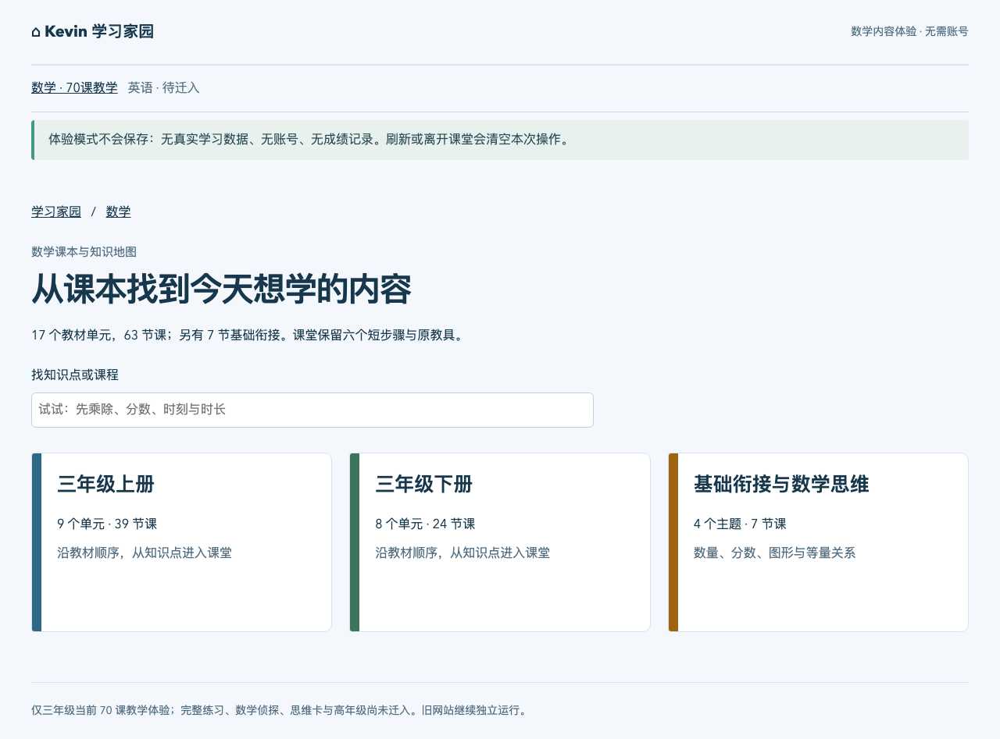

# PR #18 R3：课本目录与知识点导航

## 当前状态

R3 按 [审查意见](https://github.com/lovestream/kevin-learning-home/pull/18#issuecomment-6405768281) 继续原 PR #18、原工作副本，没有另开基础建设或重做 70 课。main 的统一整合路线图 `ab73c9b` 已合入本分支并保留。用户最新要求覆盖旧暂停点：R3 在 NAS 验收后直接继续 Issue #16 的 849 题和 Issue #17 的其它可用数学能力；不合并 Draft PR，不等待重复阶段授权。

**PASS_R3_NAS_TEXTBOOK_NAVIGATION_DELIVERED**。当前入口 [NAS 学习家园](http://192.168.2.100:38444/) 已是 R3，无需登录、证书或 Mac 本地服务。NAS 部署源码为 `020ceb9a6792a18e8d020914ec4250b631ef13d0`，不是后续证据文档提交。部署源码精确 HEAD 的 [push CI](https://github.com/lovestream/kevin-learning-home/actions/runs/40253781809) 与 [PR CI](https://github.com/lovestream/kevin-learning-home/actions/runs/40253785707) 全部成功。最终证据提交的 CI 以 PR 正文的精确 HEAD 记录为准。

## NAS 实际交付证据

| 项目 | 实测结果 |
| --- | --- |
| 镜像 | `sha256:942c3001a5f703a38c8d90cd7ca2a21b0360f6b05f7c262d3c11c26641d31690` |
| 活跃容器 | `klh-math-preview-20261025-c6ae9e7f-020ceb9a6792-app`；ID `159ef39bdc11e872045dfb42e286eb7c7c59844c1cabf52939c16f67fe51642a` |
| 运行限制 | 非 root 1024:100、只读根、零挂载、256 MiB、cpuset 0、全部 capabilities 丢弃、no-new-privileges |
| 目录导航 | 390/768/1280 三视口全通过，13,290 ms；每视口核验全部 17 单元、70 唯一入口及搜索、返回、刷新、后退 |
| 课堂回归 | 30 代表课 18,147 ms；全部 210 课堂/视口场景 125,314 ms；runner HEAD 为 020ceb9，工作树无未提交变更 |
| 回退恢复 | 实际 R3→R2 HTTP→R3；原 R2 容器/镜像保留，最终 R3 正常运行 |
| 服务与数据保护 | 11 个受保护容器前后快照完全相同；旧合成数据及 TLS 文件 hash 完全相同 |
| 构建对应 | 169 个发布输入与部署源码一致；NAS 11 个静态 seal 文件与测试构建一致 |
| 普通浏览器 | 用户 Mac 的普通 Chrome 实际刷新 R2→R3，进入上册/混合运算/先乘除课堂、返回原单元；无登录和证书绕过 |
| 实体手机/iPad | `NEEDS_USER_ACTION`；三视口自动化不冒充实体设备验收 |

[完整交付回执](evidence/math-full-r3/delivery.json)、[导航原始结果](evidence/math-full-r3/navigation-nas.json)、[210 场景](evidence/math-full-r3/nas-browser.json)、[回退](evidence/math-full-r3/rollback.json)、[169 输入](evidence/math-full-r3/release-inputs.json)、[静态 seal](evidence/math-full-r3/static-seal.json)、[截图 hash](evidence/math-full-r3/screenshots.json) 已归档。18 张响应式截图及普通 Chrome 三张截图均来自实际 NAS。Mac 仍使用 `/Users/yako/Documents/Kevin-Learning-Home-Trial/` 原目录的快捷方式和指南，已核实内容与权限，没有再创建项目副本。

## 目录结构与来源

- 数学首页只显示三年级上册、下册和基础衔接三个入口，取消 70 张卡平铺。
- 上册 9 单元 39 课、下册 8 单元 24 课，按照原教材单元顺序显示印刷页、课数及覆盖主题；单元可折叠，进入后按原 coverage.topic 找课。
- 63 节教材课加 7 节独立衔接恰好 70，每课唯一分配。桥梁分数量与运算、分数、面积与周长、等量替换与天平四个导航主题，不伪造教材章节。
- B 主线、E 提升、O 思想、R 复习分别保留；E01→E03→E02 的原顺序不使用字典排序。两节 R01 在目录及课堂分类说明中显示“复习 R”，原 DTO 字段和教学内容不变。
- G3-U03 的 3 节延伸在原 70 课成品中存在，但不在任何原 textbookUnit.sequence 或 coverage 中；按冻结成品顺序 E01、E02、O01 追加“补充拓展”，不改写原知识点。

冻结源 `math-learning@a7c05aaa8d9c5eabae4f3453807f830da1cbf279:content/course-plan-v2/grade-3.json` 只投影 units 的 id/term/title/printedPages/coverage.topic/coverage.lessons/sequence。原 lessons（含答案）、教材 PDF、账户和学习记录均不进入新服务。参考 `src/UnitLearningMap.tsx` 的目录语义，没有复制其进度、审核、账号或积分运行态。

导入工具 `scripts/math-full-01/import-map.mjs` 只用 git show 读取冻结 blob，检查旧工作区前后状态不变。[来源台账](evidence/math-full-r3/source.json) 记录原 blob/文件 hash、102 个原字段值 hash、目标 hash 和明确的延伸规则。新 `learning-map.json` 是严格 schema 的有限白名单；目录 canonical SHA-256 写入 catalog，catalog 再由构建 seal 校验，客户端也独立验证目录 hash。17 单元顺序、39+24+7、合法引用、唯一覆盖、先修关系无循环及异常字段均有门禁。

## 动线与界面

`/subjects/math?term=upper&unit=G3-U02` 等深链记录教材位置。课堂面包屑为学习家园 / 数学 / 上下册 / 单元 / 课程名；“返回混合运算”等链接恢复单元位置，相邻课堂按本册原顺序，不能跳到另一册。刷新、浏览器后退和手机点按都使用真实链接，搜索只把检索词写入当前 URL，不保存学习状态。

搜索覆盖课程、单元、原知识点和有限常见数学关键词，结果显示册 / 单元 / 知识点路径；退出检索返回原单元，支持空结果。源术语及印刷页不被改写。七节衔接仍自由进入，推荐先修不锁课。

视觉保留原纸面蓝色与字体系，不改教具或六步美术；只新增课本入口、原序单元、知识点分层和导航。没有已完成百分比、进度、积分或伪造练习；当前练习仍明确“待接入”。

## 验证与发布设计

已通过 23 个内容/模型/HTTP/目录 Node 测试（原 16 + 目录 5 + HTTP/hash 2），11 个部署保护测试及 typecheck。新真实前后端导航脚本覆盖 390/768/1280 的上册→混合运算→先乘除→课堂→返回、下册→年/月/日→时刻时长、衔接、全 17 单元全部 70 入口、搜索/退出/空结果、刷新/后退、键盘折叠、零写请求和零 cookie。原 30/210 课堂门禁、60 Node / 18 UI / 12 数学 Node / 9 数学浏览器及 Docker/Compose/恢复全部保留。

候选发布复用既有无数据预览网络与专用目录，`infra/math-preview/release.py` 加载 CI 验证的、精确 HEAD 的独立 Linux/amd64 内容镜像；先无宿主端口内部启动，再只停止当前 owned 预览容器让出 NAS `192.168.2.100:38444`。每个发布记录独立容器 ID、image ID 和私网 IP，保留先前容器/镜像/归档；原 R2 可直接回退，最初合成单课和原 38443/8 服务仍不动。新容器维持非 root、只读根、零学习挂载、256 MiB、cpuset 0、无真实数据库。

`stage` / `activate` / `rollback` 不修改 daemon、系统权限、Tailscale、DSM 或证书。保护快照仅排除已登记且核对 exact ID/image/owner/零挂载的本次发布容器；未登记或被替换的容器不得被静默排除。创建候选容器失败也会恢复之前 owned 入口，离线回归验证该失败路径。旧单课切换工具在版本化发布活跃时拒绝写操作，避免误操作旧回退命令。

## 后续连续推进

R3 真 NAS 验收后，立即在接口稳定版本上做 Issue #16 的独立 Draft PR，接入原 849 道练习的五组五型和首答→三项自查→终答，解释题保持人工核对。同样发布到该 NAS 入口。再按 Issue #17 只读盘点并迁入已存在、可公开的其它数学能力。尚未开放账户、真实成绩、积分发放或蛋仔持久化。

统一目标见 [Kevin Home 整合路线图](KEVIN-HOME-INTEGRATION-ROADMAP.md)：共用学习家园壳、学科路径和未来受控学习事件；数学与英语使用各自合适的学习交互，共享未来统一积分与宠物规则，不成为四个独立网站的跳转集合。本轮不提前启用真实钱包或合并旧钱包数据。
