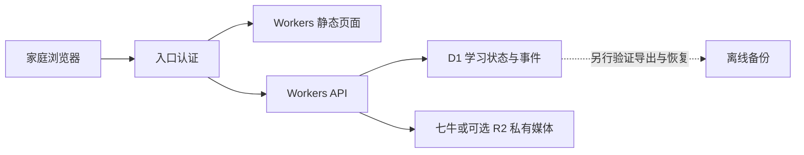

# Kevin Learning Home：Cloudflare 免费路线可行性评估

评估日期：2026-10-13。状态：**RECOMMEND_FOR_NEXT_VALIDATION / PENDING_USER_DECISION**。这是应用户最新问题完成的架构与费用研究，没有部署、开通订阅、创建云数据库或开始 PR-1B。官方额度是查询日快照；账户当前套餐、用量及真实数据体积未读取。

## 结论与建议架构

家庭低流量使用适合优先验证 Cloudflare，页面、轻量 API 和学习记录很可能落在免费额度内。建议 React/Vite 构建产物用 Workers Static Assets，API 用 Workers，学习记录用 D1，图片/音频/原始导入快照用现有七牛或可选 R2，入口用 Access 邮箱白名单或经过验证的应用认证。NAS 可以成为人工保存离线备份的地点，网站运行不再依赖 NAS 开机；本轮未配置备份。

七牛 MCP Server 已能使用，说明用户熟悉云端服务，但不能据此证明学习网站的数据库、认证、CPU预算和浏览器访问都已兼容。此处媒体沿用七牛只是候选，没有检查或修改其凭证、存储桶或套餐。

## 已核验的免费额度与收费边界

| 部分 | 当前官方额度 | 本项目的条件 |
| --- | --- | --- |
| 静态页面 | 直接静态资产请求免费、不限请求次数；Free 每版本最多 20,000 文件，单文件 25 MiB | 若先执行 Worker 做认证/路由，对应调用按动态请求计；大音视频移对象存储。见 [计费](https://developers.cloudflare.com/workers/platform/pricing/)与[限制](https://developers.cloudflare.com/workers/platform/limits/) |
| Workers API | Free 每账户每天 100,000 次请求，每次 10 ms CPU，128 MB 内存 | CPU 时间不是网络等待时间；批量导入、密码散列、图像处理和大 JSON 要单独测量。同账户其他 Worker/MCP 的请求共享额度。见[官方限制](https://developers.cloudflare.com/workers/platform/limits/) |
| D1 | 每天读 5,000,000 行、写 100,000 行；账户共 5 GB，Free 单库 500 MB、最多 10 库 | 读额度按扫描行计算，索引维护会增加写入；Free 超日额度会查询报错，不能当无限免费。见[定价](https://developers.cloudflare.com/d1/platform/pricing/)与[限制](https://developers.cloudflare.com/d1/platform/limits/) |
| 可选 R2 Standard | 每月 10 GB-month、100 万 Class A、1,000 万 Class B；直接外传流量免费 | 需要 R2 计费订阅，超免费额度按量收费；Infrequent Access 不享此免费额度。见[定价](https://developers.cloudflare.com/r2/pricing/)与[开通说明](https://developers.cloudflare.com/r2/get-started/) |

举例估算（虚构负载，不是家庭实际用量）：每天 1,000 次动态请求，500 个学习事件，每事件共写 10 行则为 5,000 行写入；这些数字明显低于日额度，但仍须加入索引写入、自动保存、重试、后台查询和同账户 MCP 用量。所有请求均需满足 CPU 预算，累计数据库需低于单库容量。

若最终确实需要 Workers Paid，最低为每账户 US$5/月，超包含额度另计；这是后续选择，当前未开通。域名、七牛、AI/TTS 接口等费用不包含在 Workers 免费额度中。[Workers 定价](https://developers.cloudflare.com/workers/platform/pricing/)

Cloudflare Containers 不属于 Workers Free，需要 Paid 及容器资源计费；其默认磁盘生命周期也不能当成 NAS 持久化数据卷，因此不建议为了免后端适配而直接搬 Docker。[Containers 定价](https://developers.cloudflare.com/containers/platform/pricing/)、[容器 FAQ](https://developers.cloudflare.com/containers/faq/)

## 与现有架构的具体差异

当前新仓库是 Phase0 架构文件与 PR-1A 合成探针，业务后端尚未实现。现在明确运行目标，比完成 Node 后端后再搬迁更合适；这属于架构判断，不代表已完成云端验证。

| 现有目标/来源 | Cloudflare 路线所需调整 | 必须保留的行为 |
| --- | --- | --- |
| Node 24、`node:sqlite` DatabaseSync、本地 WAL/FULL 文件 | Workers 是独立运行时；官方 `node:sqlite` 仅为 stub，`/tmp` 按请求临时存在；改为 D1 异步存储适配器 | SQLite 探针保留为原路线证据，不能把其 PASS 记作 D1 PASS。见[兼容旗标](https://developers.cloudflare.com/workers/configuration/compatibility-flags/#enable-nodesqlite-module)、[文件系统](https://developers.cloudflare.com/workers/runtime-apis/nodejs/fs/) |
| `BEGIN IMMEDIATE` 内读取状态、执行 JS mutate、写 evidence/receipt/revision | D1 `batch()` 有批次失败回滚语义，但不等价于任意 JS 回调事务；设计条件 SQL、revision CAS、唯一 command receipt 和错误返回 | 重复命令不重复结算；载荷冲突、过期 revision 返回一致的 409；状态与回执原子提交。必须合成测试并发/失败回滚。见[D1 API](https://developers.cloudflare.com/d1/worker-api/d1-database/#batch) |
| 单行完整 `subject_state.payload_json`，英语自定义图可为 base64 | D1 单字符串/BLOB/行最大 2,000,000 bytes，单次 Free 调用最多 50 查询；不能假设完整历史状态永远适合一行 | 另提存储 ADR，评估分片状态、事件/索引及对象引用；原始 bytes/hash、全部字段及可恢复映射保留，禁止删数据以迎合限制。见[D1 限制](https://developers.cloudflare.com/d1/platform/limits/) |
| 家长 scrypt PIN、30分钟内存 session/限频 | 不能依赖单进程内存存放跨请求会话；重新验证密码散列 CPU，持久会话/授权与 CSRF、防重放 | 家长批阅、导入、恢复等受服务端权限保护；Access 入口保护不能代替 learner/parent scoped grants |
| `VACUUM INTO`、本地快照恢复 | D1 使用平台导出/恢复及外部离线副本；Free Time Travel 7 天 | 完整性、原始导入来源、导出权限、备份保留和空库恢复须另外验证。见[限制](https://developers.cloudflare.com/d1/platform/limits/)、[导入导出](https://developers.cloudflare.com/d1/best-practices/import-export-data/) |
| React/Vite、数学课程、英语复习与两个积分钱包 | 前端可构建为静态页面；API/媒体 URL 和后端适配需要验证 | 不重构课程/复习算法，不合并钱包，不改旧项目，不读取真实记录 |

私有网站仍需访问控制。`workers.dev` 可以配 Access 限制指定用户，同时应保护预览地址及所有数据/媒体入口；本轮未配置。Access 免费套餐的账户开通条件需在实际设置时核验，本文不承诺当前账户已具备。[workers.dev Access 说明](https://developers.cloudflare.com/workers/configuration/routing/workers-dev/)

## 稳定性与待验证项

Cloudflare 托管计算可减少 NAS 电源、旧内核及家庭上行依赖，这是架构上的收益。NAS 本轮结果是 daemon 权限 **BLOCKED**，没有 Node/SQLite 运行失败证据，不能写成已证明不稳定。[NAS 实测报告](PR-1A-nas-validation-report.md)

若主要在中国大陆访问，必须用实际 iPad/Mac、家庭宽带和手机网络测试登录、页面、API及媒体。Cloudflare 官方说明境外路径可能有延迟/可靠性问题；China Network 是 Enterprise 的单独订阅，免费路线不包含该服务。因此“云端运行更省维护”不能自动推导“家庭网络访问一定更稳定”。[官方 China Network 说明](https://developers.cloudflare.com/china-network/)

建议 ChatGPT 审查后另签 Cloudflare 合成兼容任务，验收至少包括：D1 原子失败回滚、CAS 并发与幂等冲突；跨请求/部署的持久化；两个钱包隔离；超 2 MB 状态和媒体保存策略；家长权限与入口绕过；CPU/扫描行预算；导出到新库恢复；实际设备网络体验。远端创建 Worker/D1/R2/Access、域名绑定或任何计费开通须在新任务中明确范围；本次只交付研究文档，不自动执行以上候选项。

PR #1 继续等待独立复审，不合并、不进入 PR-1B。该候选路线不会自行改写 Phase0 原始契约；若被选中，须先批准补充 ADR 与接口/迁移清单差异，再实施。
